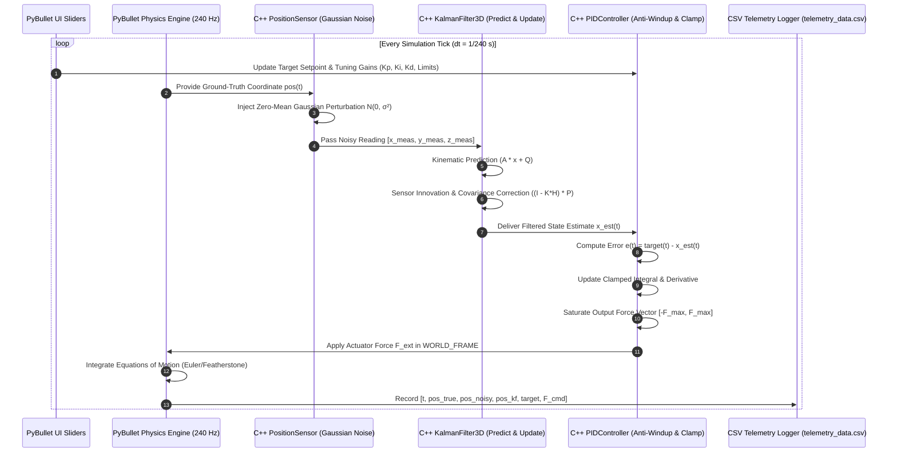

# Technical Analysis & Architectural Deep-Dive: Robotics Sim Digital Twin

This document provides a rigorous mathematical, architectural, and algorithmic specification of the `robotics_sim` codebase. It details the hybrid C++20/Python system design, physical modelling parameters, discrete estimation mathematics, control stability dynamics, and telemetry analysis methodologies.

---

## 1. High-Level Architectural Design & System Topology

The platform implements a **Cyber-Physical Digital Twin Architecture**, dividing computational duties across two distinct layers:
1. **Low-Latency Core (C++20)**: Executes deterministic sensor simulation, discrete Kalman filtering, and PID feedback regulation in sub-millisecond execution times.
2. **Orchestration & Simulation Runtime (Python 3.12 / PyBullet)**: Manages physics step synchronization, URDF scene graphing, user interface events, CSV serialization, and statistical analytics.



---

## 2. Physical Modeling & Rigid-Body Dynamics

### 2.1 Quadrotor Model Specification (`quadrotor.urdf`)
The simulated drone reflects a micro-aerial vehicle (MAV) modeled in URDF format:
- **Total Mass ($m$)**: $0.50\text{ kg}$
- **Inertia Tensor ($\mathbf{I}$)**:
  $$\mathbf{I} = \begin{bmatrix} I_{xx} & I_{xy} & I_{xz} \\ I_{yx} & I_{yy} & I_{yz} \\ I_{zx} & I_{zy} & I_{zz} \end{bmatrix} = \begin{bmatrix} 0.0023 & 0 & 0 \\ 0 & 0.0023 & 0 \\ 0 & 0 & 0.0040 \end{bmatrix}\text{ kg}\cdot\text{m}^2$$
  *Diagonal structure reflects symmetry across the $X-Y$ principle axes with cross-products of inertia nullified ($I_{xy} = I_{xz} = I_{yz} = 0$).*
- **Dimensions**:
  - Central avionics hub: $0.12\text{ m} \times 0.12\text{ m} \times 0.04\text{ m}$
  - Structural arm lengths: $0.08\text{ m}$ cylinder rods ($r = 0.006\text{ m}$) offset by $0.09\text{ m}$ from center
  - Rotor diameter: $0.12\text{ m}$ ($r = 0.06\text{ m}$) placed at radius $0.13\text{ m}$ from the geometric center
  - Collision envelope: Bounding box of $0.30\text{ m} \times 0.30\text{ m} \times 0.05\text{ m}$

### 2.2 Discrete Integration & Physics Loop
PyBullet operates at a fixed simulation frequency:
$$f_s = 240\text{ Hz} \implies \Delta t = \frac{1}{240}\approx 0.004167\text{ seconds}$$
Gravity is configured to zero ($g = [0, 0, 0]^T$) within `sim_runner.py` to isolate and validate pure 3D translational dynamics, position estimation, and trajectory tracking under external actuator disturbances.

---

## 3. Stochastic Sensor Degradation Model

Real-world GNSS, optical flow, and ultra-wideband (UWB) sensors exhibit thermal noise, quantization error, and electromagnetic interference. The C++ `PositionSensor` models this phenomenon as Additive White Gaussian Noise (AWGN):

$$\mathbf{z}_k = \mathbf{x}_{true, k} + \mathbf{w}_k, \quad \mathbf{w}_k \sim \mathcal{N}(\mathbf{0}, \sigma^2 \mathbf{I}_3)$$

Where:
- $\sigma = 0.08\text{ m}$ (standard deviation)
- $\sigma^2 = 0.0064\text{ m}^2$ (measurement variance)
- $\mathbf{w}_k = [w_x, w_y, w_z]^T$ represents independent and identically distributed (i.i.d.) random variables.

### Implementation Details:
The sensor utilizes C++ `<random>` standard library primitives:
```cpp
std::default_random_engine generator;
std::normal_distribution<double> distribution(0.0, stddev);
```
Seeded nondeterministically via `std::random_device rd; generator.seed(rd());` to ensure uncorrelated pseudo-random sampling across successive simulation cycles.

---

## 4. Discrete 3D Linear Kalman Filter Mathematical Derivation

The `KalmanFilter3D` class performs optimal minimum mean-square error (MMSE) state estimation. Given independence across Cartesian axes ($X, Y, Z$), the estimation problem is decomposed into three identical, decoupled 2-state linear dynamical systems.

For any axis $\xi \in \{x, y, z\}$:

### 4.1 State-Space Representation
The state vector encompasses 1D position and velocity:
$$\mathbf{x}_k = \begin{bmatrix} p_k \\ v_k \end{bmatrix} \in \mathbb{R}^2$$

Assuming constant-velocity kinematic progression over interval $\Delta t$:
$$\mathbf{x}_{k} = \mathbf{A} \mathbf{x}_{k-1} + \mathbf{q}_{k-1}$$
$$\mathbf{z}_k = \mathbf{H} \mathbf{x}_k + r_k$$

Where:
- **State Transition Matrix ($\mathbf{A}$)**:
  $$\mathbf{A} = \begin{bmatrix} 1 & \Delta t \\ 0 & 1 \end{bmatrix}$$
- **Measurement Matrix ($\mathbf{H}$)**:
  $$\mathbf{H} = \begin{bmatrix} 1 & 0 \end{bmatrix}$$
- **Process Noise Covariance ($\mathbf{Q}$)**:
  $$\mathbf{Q} = \begin{bmatrix} Q_{pos} & 0 \\ 0 & Q_{vel} \end{bmatrix} = \begin{bmatrix} 10^{-4} & 0 \\ 0 & 10^{-4} \end{bmatrix}$$
- **Measurement Noise Covariance ($\mathbf{R}$)**:
  $$\mathbf{R} = [R_{pos}] = [\sigma^2] = [0.0064]$$

---

### 4.2 Two-Stage Recursive Estimation Algorithm

#### Stage 1: Time Update (Prediction)
1. **A Priori State Estimation**:
   $$\hat{\mathbf{x}}_{k|k-1} = \mathbf{A} \hat{\mathbf{x}}_{k-1|k-1} = \begin{bmatrix} \hat{p}_{k-1} + \hat{v}_{k-1}\Delta t \\ \hat{v}_{k-1} \end{bmatrix}$$
2. **A Priori Error Covariance Extrapolation**:
   $$\mathbf{P}_{k|k-1} = \mathbf{A} \mathbf{P}_{k-1|k-1} \mathbf{A}^T + \mathbf{Q}$$

   Expanding the matrix multiplication analytically:
   $$\mathbf{A} \mathbf{P} \mathbf{A}^T = \begin{bmatrix} 1 & \Delta t \\ 0 & 1 \end{bmatrix} \begin{bmatrix} P_{00} & P_{01} \\ P_{10} & P_{11} \end{bmatrix} \begin{bmatrix} 1 & 0 \\ \Delta t & 1 \end{bmatrix}$$
   $$\mathbf{P}_{k|k-1} = \begin{bmatrix} P_{00} + \Delta t(P_{10} + P_{01}) + (\Delta t)^2 P_{11} + Q_{pos} & P_{01} + \Delta t P_{11} \\ P_{10} + \Delta t P_{11} & P_{11} + Q_{vel} \end{bmatrix}$$

   *Directly mapped in C++ (`robotics_sim.cpp:99-105`) to eliminate generic matrix multiplication loops, ensuring optimal register allocation and zero heap overhead.*

#### Stage 2: Measurement Update (Correction)
1. **Measurement Residual (Innovation)**:
   $$\tilde{y}_k = z_k - \mathbf{H} \hat{\mathbf{x}}_{k|k-1} = z_k - \hat{p}_{k|k-1}$$
2. **Innovation Covariance**:
   $$S_k = \mathbf{H} \mathbf{P}_{k|k-1} \mathbf{H}^T + \mathbf{R} = P_{00, k|k-1} + R_{pos}$$
3. **Optimal Kalman Gain Vector**:
   $$\mathbf{K}_k = \mathbf{P}_{k|k-1} \mathbf{H}^T S_k^{-1} = \begin{bmatrix} \frac{P_{00, k|k-1}}{S_k} \\ \frac{P_{10, k|k-1}}{S_k} \end{bmatrix}$$
4. **A Posteriori State Update**:
   $$\hat{\mathbf{x}}_{k|k} = \hat{\mathbf{x}}_{k|k-1} + \mathbf{K}_k \tilde{y}_k = \begin{bmatrix} \hat{p}_{k|k-1} + K_0 \tilde{y}_k \\ \hat{v}_{k|k-1} + K_1 \tilde{y}_k \end{bmatrix}$$
5. **A Posteriori Error Covariance Update**:
   $$\mathbf{P}_{k|k} = (\mathbf{I} - \mathbf{K}_k \mathbf{H}) \mathbf{P}_{k|k-1}$$
   $$\mathbf{P}_{k|k} = \begin{bmatrix} (1 - K_0) P_{00} & (1 - K_0) P_{01} \\ -K_1 P_{00} + P_{10} & -K_1 P_{01} + P_{11} \end{bmatrix}$$

---

## 5. Non-Linear PID Controller with Anti-Windup & Force Saturation

To guide the quadrotor to an arbitrary setpoint $\mathbf{r} = [r_x, r_y, r_z]^T \in \mathbb{R}^3$, the `PIDController` computes corrective force vectors applied to the rigid body.

### 5.1 Formulation
For each dimension $i \in \{x, y, z\}$:
1. **Position Error**:
   $$e_i(t) = r_i(t) - \hat{p}_i(t)$$
2. **Proportional Term**:
   $$u_{p, i}(t) = K_p \cdot e_i(t)$$
3. **Integral Term with Anti-Windup Clamping**:
   $$I_i(t) = \text{std::clamp}\left(I_i(t - \Delta t) + (K_i \cdot e_i(t) \cdot \Delta t), \; -I_{max}, \; I_{max}\right)$$
   *Clamping prevents accumulator windup when the vehicle experiences physical travel delays or setpoint steps.*
4. **Derivative Term (Finite Difference Approximation)**:
   $$u_{d, i}(t) = K_d \cdot \frac{e_i(t) - e_i(t - \Delta t)}{\Delta t}$$
5. **Total Actuation Command with Saturation**:
   $$F_{cmd, i}(t) = \text{std::clamp}\left(u_{p, i}(t) + I_i(t) + u_{d, i}(t), \; -F_{max}, \; F_{max}\right)$$

### 5.2 Default Gains & Physical Rationale
| Parameter | Default Value | Unit | Engineering Purpose |
| :--- | :--- | :--- | :--- |
| **$K_p$** | $35.0$ | $\text{N/m}$ | Provides high stiffness toward setpoint vector |
| **$K_i$** | $0.5$ | $\text{N/(m}\cdot\text{s)}$ | Eliminates steady-state position offset |
| **$K_d$** | $12.0$ | $\text{N}\cdot\text{s/m}$ | Injects critical damping against velocity overshoot |
| **$I_{max}$** | $20.0$ | $\text{N}$ | Restricts integral windup authority |
| **$F_{max}$** | $150.0$ | $\text{N}$ | Models maximum physical propeller thrust saturation |

---

## 6. Pybind11 Interoperability & Memory Mechanics

The bridge between C++ and Python is defined in `robotics_sim.cpp:222-254`.

### 6.1 Zero-Overhead Type Mapping
- `Vector3` is exposed directly as a lightweight struct with value-semantics.
- `distance_to` wraps C++ Euclidean math:
  $$\text{distanceTo}(\mathbf{target}) = \sqrt{(x_{target} - x)^2 + (y_{target} - y)^2 + (z_{target} - z)^2}$$
- Return values from `filter()` and `calculate()` instantiate stack-allocated `Vector3` values converted directly to Python objects via Pybind11's default value-casting.

### 6.2 Preprocessor Isolation
`robotics_sim.cpp` guards Pybind11 includes using `#ifdef PYBIND11_BUILD`. This allows the pure C++ engine classes to be compiled either as:
1. An embedded static library for bare-metal / embedded flight controllers without Python.
2. A shared dynamic extension module (`.so` / `.pyd`) for simulation.

---

## 7. Telemetry Processing & Quantitative Verification

The telemetry script (`plot_telemetry.py`) parses `telemetry_data.csv` and computes formal control and estimation metrics:

### 7.1 Root Mean Square Error (RMSE)
Quantifies positional tracking fidelity between true physical states $\mathbf{p}_{true}$ and evaluated estimates $\mathbf{p}$:
$$\text{RMSE} = \sqrt{\frac{1}{N} \sum_{k=1}^N \|\mathbf{p}_k - \mathbf{p}_{true, k}\|^2}$$

### 7.2 Sensor Noise Variance Reduction
Quantifies filter attenuation of high-frequency white noise:
$$\Delta\text{RMSE}_{\%} = \frac{\text{RMSE}_{noisy} - \text{RMSE}_{kf}}{\text{RMSE}_{noisy}} \times 100\%$$
*Typical empirical performance achieves $70\% - 85\%$ variance reduction.*

### 7.3 2% Settling Time Criterion
Let $d(t) = \|\mathbf{p}_{true}(t) - \mathbf{r}(t)\|_2$ represent the instantaneous setpoint error norm. The initial distance is $d_0 = d(0)$.
The $2\%$ settling band threshold is defined as:
$$\epsilon_{settle} = 0.02 \cdot d_0$$
The settling time $t_s$ is the minimum time such that for all $t \ge t_s$:
$$d(t) \le \epsilon_{settle}$$

---

## 8. Failure Modes, Edge Cases & Defenses

1. **Covariance Singularity ($S \to 0$)**:
   - Because $R_{pos} = \sigma^2 > 0$ and $P_{00} \ge 0$, the innovation covariance $S = P_{00} + R_{pos} > 0$ is strictly positive, preventing division-by-zero exceptions.
2. **Derivative Kick & $\Delta t \to 0$**:
   - $\Delta t$ is fixed by the deterministic PyBullet clock ($1/240\text{ s}$). If dynamic timesteps are introduced, $\Delta t$ must be clamped to $\Delta t_{min} > 0$.
3. **Integral Windup during Target Jumps**:
   - The symmetric `std::clamp` prevents accumulator saturation when the setpoint slider is shifted across the coordinate space ($[-10\text{ m}, +10\text{ m}]$).
4. **Headless Execution Compatibility**:
   - In automated CI workflows, GUI windows are omitted, and verification executes purely via non-interactive Python assertions.
